# PPO 기반 다중 로봇 WAAM 경로 생성 및 안전 스케줄링

Task Generator로 STL 형상을 적층 작업으로 변환하고, PPO로 로봇 배정 선호도를 생성한 뒤 Scheduler v17로 안전한 작업 일정을 구성합니다.

## 모델별 적용 결과

시간 형식은 `DD:HH:MM:SS`(일:시:분:초)입니다. Makespan은 초 단위로 반올림했습니다.

| 모델 | Makespan (초) | Makespan (DD:HH:MM:SS) | 계산 시간 (DD:HH:MM:SS) | Validator 결과 |
| --- | ---: | --- | --- | --- |
| 01 · Honeycomb | 683.98 | 00:00:11:24 | 00:00:46:00 | PASS |
| 02 · Spiral | 1,865.00 | 00:00:31:05 | 00:02:38:00 | PASS |
| 03 · Triangular truss | 1,259.23 | 00:00:20:59 | 00:01:08:00 | PASS |
| 04 · Motor inner | 37,094.55 | 00:10:18:15 | 00:05:31:00 | PASS |
| 05 · Twisted shell | 100,522.34 | 01:03:55:22 | 00:17:41:00 | PASS |
| 06 · Angle frame | 5,189.37 | 00:01:26:29 | 00:02:35:00 | PASS |

Makespan은 로봇 일정의 예정 작업 시간입니다. 계산 시간은 trajectory 생성에 걸린 대략적인 경과 시간으로, 공식 Validator 실행 시간은 제외합니다.

## Validator 적용 결과

### 간트차트

Test 1부터 Test 6까지의 결과입니다.

#### Test 01

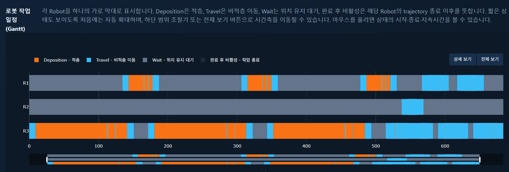

#### Test 02

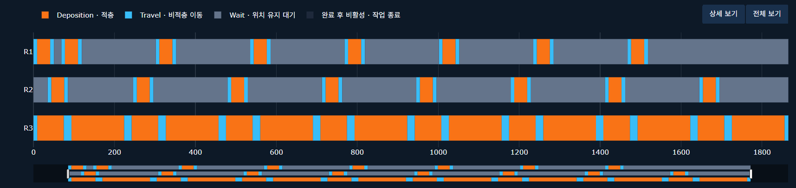

#### Test 03

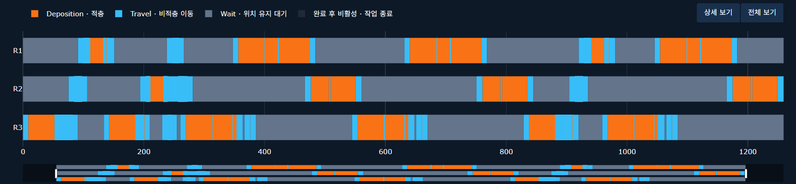

#### Test 04

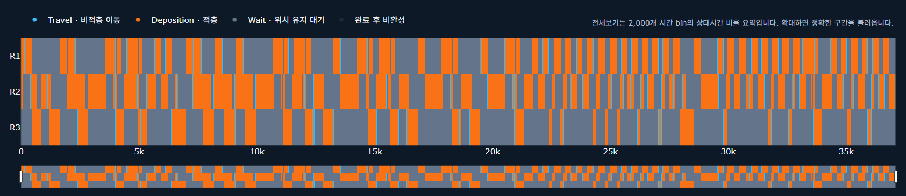

#### Test 05

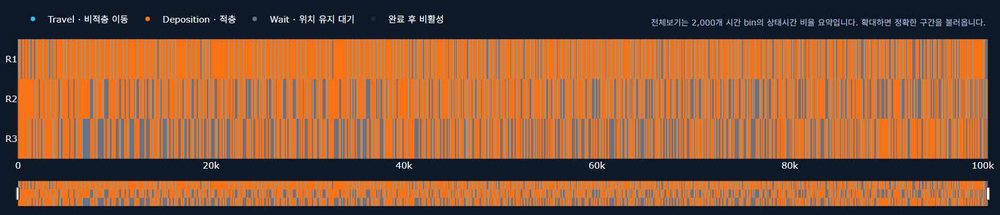

#### Test 06

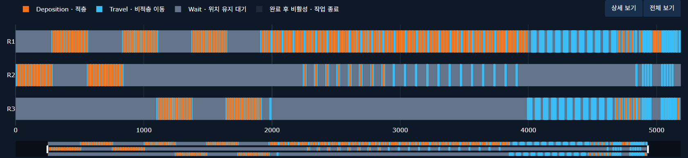

### 검증 결과 화면

#### Test 01


#### Test 02

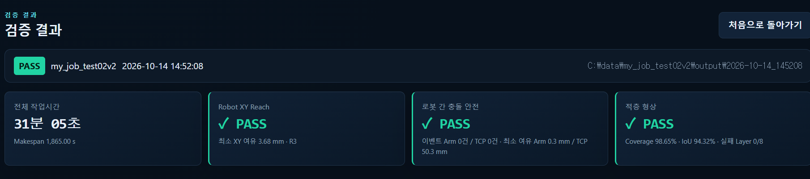

#### Test 03

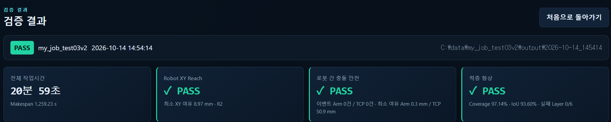

#### Test 04

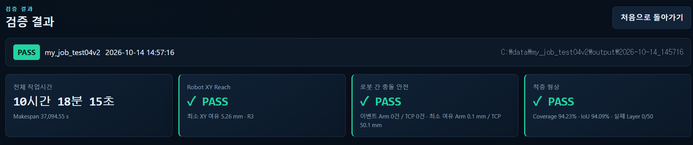

#### Test 05

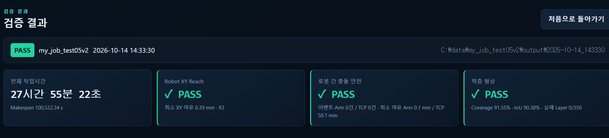

#### Test 06

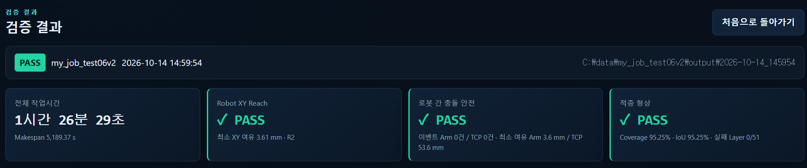

## 알고리즘 수도코드

```text
Algorithm: Task Generator + PPO-Clip + Scheduler v17
01 Input: STL M, 설정 C, 정책 πθ; tasks T←∅

A. Task Generator
02 For each layer ℓ: Aℓ←Slice(M,zℓ), zℓ=zbase+(ℓ+η)h
03     ℘ℓ←Hatch 후보 ∪ Skeleton 후보
04     For each P∈℘ℓ: D←Buffer(P,w/2); L←Σe∈P‖eend−estart‖₂
05         cov←|Aℓ∩D|/|Aℓ|; over←|D\Aℓ|/|Aℓ|; iou←|Aℓ∩D|/|Aℓ∪D|
06     F←{P: cov≥cmin ∧ over≤omax ∧ iou≥imin}; F=∅이면 종료
07     U←{P∈F: iou≥i*}; U=∅이면 U←F
08     P*←argminP∈U [L+0.05w|P|+5max(0,i*−iou)max(L,w)]
09     P*의 선분에 높이 zℓ를 부여하여 순서대로 T에 추가

B. PPO-Clip Training — 재학습 시에만 수행
10 정책 πθ·가치함수 Vφ 초기화; 기존 모델 사용 시 20행으로 이동
11 For each update: πold←πθ; rollout 수집, old log-probability·가치 저장
12     δt←rt+1+γ(1−dt+1)Vold(st+1)−Vold(st)
13     Ât←δt+γλ(1−dt+1)Ât+1 (역순); Vt_tar←Ât+Vold(st)
14     For K epochs and each shuffled mini-batch:
15         ρt←exp(log πθ(at|st)−log πold(at|st))
16         Lclip←mean[min(ρtÂt,clip(ρt,1−ε,1+ε)Ât)]
17         LV←mean[(Vt_tar−Vφ(st))²]; H←mean[−Σaπθ(a|st)log πθ(a|st)]
18         Ltotal←−Lclip+cvLV−ceH
19         (θ,φ)←(θ,φ)−αlr∇θ,φLtotal; old log-probability·Ât·Vt_tar는 고정

C. PPO Inference
20 학습된 정책을 준비하고 환경 초기화; For each task t∈T:
21     Fr,t←τr+‖xr−pt,start‖₂/vT+‖pt,end,xy−pt,start,xy‖₂/vD
22     at←argmaxaπθ(a|st); preft←argsortr(Fr,t)[at]; 환경 상태 갱신

D. Scheduler v17 + Validator
23 Sbest←충돌 검사를 통과한 V15 기본 일정; Cmax(S)←maxrCr(S)
24 Q←선분을 chain으로 연결; 공통 도달 가능 로봇이 없어지기 직전에 분할
25 V←동일 층 bundle 구성 및 생성 가능한 adaptive bundle 변형 목록
26 For k=0,...,19: B←V[k mod |V|]; 비었거나 |B|>300이면 continue
27     Ok←적층시간 오름차순(k=0), 내림차순(k=1), 순서 교환(k≥2)
28     S←최소 완료 안전 배정(Ok(B),pref); 충돌 시 지연, 배치 불가 시 분할
29     S가 존재하고 Cmax(S)<Cmax(Sbest)이며 충돌 검사 통과 시 Sbest←S
30 최종 충돌 검사 → D/T/W CSV 저장 → 공식 Validator로 결과 평가
```

$A_\ell$: 목표 단면, $D$: 비드 영역, $w$: 비드 폭, $L$: 경로 길이, $|P|$: 선분 수입니다.

PPO의 action은 로봇 ID가 아닌 **예상 완료 시각 순위**이며, Scheduler에 로봇 선호도로 전달됩니다. 이번 검증은 저장된 PPO 모델을 이용한 추론으로 수행했으며, 수도코드의 PPO-Clip 학습 단계는 재학습 시에만 수행합니다.

## 이 문제에 적용한 이유

### 1. Task Generator

STL에는 물체 표면의 형상 정보가 있지만 로봇이 따라갈 적층 선분은 포함되어 있지 않습니다. 따라서 층별 단면을 추출하고 비드 폭을 고려하여 실제 적층 경로를 생성해야 합니다.

Task Generator는 단면마다 형상과 비용을 평가하여 경로를 선택합니다. 3차원 형상을 한 번에 비교하는 대신 각 층에서 경로 후보를 평가할 수 있다는 점을 활용했습니다.Coverage, Overfill, IoU를 평가하고 조건을 만족하는 후보 중 경로 비용이 낮은 경로를 선택합니다.

- **Coverage:** 목표 단면 중 적층 비드가 덮는 비율
- **Overfill:** 목표 단면 밖으로 초과 적층되는 비율
- **IoU:** 목표 단면과 비드 영역의 교집합/합집합 비율
- **선택 기준:** 경로 길이, 선분 수, 목표 IoU 미달 패널티

### 2. PPO (Proximal Policy Optimization)

같은 선분이라도 로봇의 현재 위치와 누적 작업 시간에 따라 적합한 로봇이 달라집니다. 당장 유리한 배정이 이후 작업에서도 유리하다고 보장할 수는 없습니다.

현재 상태와 이후 누적 보상을 고려하는 PPO를 활용하여 상태에 따른 로봇 배정 선호도를 제공하고자 했습니다. 선택한 순위는 Scheduler에 로봇 선호도(`pref`)로 전달됩니다.

- **Training:** rollout 수집, GAE 기반 Advantage 계산, PPO-Clip 목적함수 최적화
- **Inference:** 현재 상태에 따라 정책 행동 선택 및 로봇 선호도 생성
- **적용 이유:** 단순 고정 규칙 대신 상태에 따라 달라지는 작업 배정 선호도를 학습하기 위함

| 설정 항목 | 값 | 설명 |
| --- | --- | --- |
| Learning rate | 0.0003 | 학습률 |
| Rollout steps (`n_steps`) | 4,096 | 업데이트 전 환경당 수집 step 수 |
| Batch size | 64 | 미니배치 크기 |
| Epochs (`n_epochs`) | 10 | 수집 데이터의 반복 학습 횟수 |
| Discount factor (`gamma`) | 0.99 | 미래 보상의 할인율 |
| GAE lambda | 0.95 | Advantage 추정 계수 |
| Clip range (`epsilon`) | 0.2 | PPO 확률비 clipping 폭 |
| Entropy coefficient | 0.01 | 엔트로피 항의 가중치 |
| Value coefficient | 0.5 | 가치함수 손실 가중치 |
| Max gradient norm | 0.5 | Gradient clipping 기준 |
| Advantage normalization | True | Advantage 정규화 |
| Value function clipping | None | 미사용 |
| Random seed | 42 | 저장된 모델의 난수 시드 |
| 학습 환경 수 | 1 | 병렬 환경 수 |
| 목표 학습 step | 20,000 | 설정된 목표 학습량 |
| 기록된 누적 step | 20,480 | 체크포인트에 기록된 학습량 |
| 상태 벡터 차원 | 25 | Observation dimension |
| 행동 공간 | Discrete(3) | 예상 완료 시각 순위 0·1·2 |
| 추론 방식 | deterministic=True | 최대 확률 action 선택 |

#### Reward 함수

Reward는 `algorithm/environment/waam_env.py`의 `step()` 함수에서 계산합니다.

$$
r_t =
-\left(M_{t+1}-M_t\right)
-0.5\frac{\sigma(\boldsymbol{\tau}_{t+1})}{\mu(\boldsymbol{\tau}_{t+1})}
-0.2\frac{\tau_{a,t+1}-\min_i\tau_{i,t+1}}{1000}
+20\,\mathbb{1}_{\mathrm{done}}
$$

충돌은 보상함수의 페널티로 반영하지 않고, 스케줄러의 별도 안전 제약으로 처리한다. PPO는 작업 시간과 부하를 고려한 배정 선호도를 제공하며, 스케줄러는 충돌 검사와 시작 시각 조정을 통해 실행 가능한 일정을 구성한다.

| 기호 | 의미 |
| --- | --- |
| $M_t$ | 배정 전 환경 내부 makespan |
| $M_{t+1}$ | 배정 후 환경 내부 makespan |
| $\boldsymbol{\tau}_{t+1}$ | 배정 후 로봇별 누적 이동·적층 시간 벡터 |
| $\sigma,\mu$ | 로봇별 누적 시간의 표준편차와 평균 |
| $\tau_{a,t+1}$ | 선택된 로봇의 배정 후 누적 시간 |
| $\mathbb{1}_{\mathrm{done}}$ | 모든 작업 완료 시 1, 그 외 0 |

##### 설계 의도

- **Makespan 증가 억제:** 작업 배정으로 증가한 최대 누적 시간에 페널티를 부여합니다.
- **작업 불균형 완화:** 로봇별 누적 시간의 표준편차를 평균으로 나눈 값에 페널티를 부여합니다.
- **부하 집중 억제:** 선택된 로봇과 가장 여유 있는 로봇의 누적 시간 차이에 페널티를 부여합니다.
- **완료 보너스:** 모든 작업을 완료하면 +20의 보상을 부여합니다.

평균 누적 시간이 0이면 불균형 항은 0으로 처리합니다.
부하 항의 1000은 시간 정규화 계수의 기본값입니다.

이 reward는 환경 내부의 이동·적층 시간을 기준으로 계산하며,
scheduler가 추가하는 충돌 회피 대기 시간은 직접 반영하지 않습니다.
도달 범위와 충돌 여부는 scheduler 및 공식 Validator에서 별도로 검사합니다.

> 위 식은 현재 환경 코드 기준이며, 기존 체크포인트의 학습 당시에도
> 동일한 식을 사용했는지는 학습 당시 코드와 로그를 통해 확인해야 합니다.

### 3. Scheduler v17

작업을 로봇별로 안전하게 배정하고 순서 및 시점을 조정해 Makespan을 줄입니다.

| 역할 | 설명 |
|---|---|
| Task Assignment | 로봇의 도달 범위와 선호도를 고려한 작업 배정 |
| Task Sequencing | Chain/Bundle 처리 순서 탐색 |
| Scheduling | 로봇별 시작·종료 시각과 대기시간 조정 |
| Collision Avoidance | 충돌 발생 시 작업 지연 또는 Bundle 분할 |
| Makespan Optimization | 충돌 검사에 통과하면서 기존 일정보다 짧은 일정 채택 |

보고서의 Scheduler v17은 충돌 검사를 통과한 **V15 기본 일정**을 초기 해로 삼고, Bundle 변형 및 작업 순서 후보를 탐색합니다. 후보 일정이 안전하며 Makespan이 더 짧을 때만 최적 일정을 갱신합니다.

#### Bundle의 역할

**Bundle**은 같은 Layer에 있는 인접 Chain을 묶어 연속 작업하도록 구성하는 단위입니다. 즉 **같은 층의 여러 chain을 하나의 작업 단위로 묶은 것**으로 볼 수 있습니다.

- **Task:** 하나의 적층 선분
- **Chain:** 연결된 적층 선분들의 연속 경로
- **Bundle:** 같은 층의 가까운 chain들을 묶은 배정 단위
```text
적층 선분(Task) → 연속 경로(Chain) → 작업 묶음(Bundle)
```
1. Chain 위치와 거리 분석
2. 동일 층의 인접 Chain을 Bundle로 구성
3. Chain 사이 직접 Travel 경로 생성
4. 충돌 및 작업 가능 여부 확인
5. 배치 불가능하거나 충돌 시 Bundle을 더 작은 단위로 분할

Bundle은 불필요한 HOME 왕복과 비가공 이동시간을 줄이는 데 기여할 수 있습니다. 단, 실제 개선 폭은 동일 조건의 Bundle 적용 전후 비교로 확인해야 합니다.

## 알고리즘의 특징과 장단점

| 구성 요소 | 특징 | 장점 | 한계 |
| --- | --- | --- | --- |
| Task Generator | 층별 단면에서 후보를 생성하고, 형상 제약을 만족하는 경로 중 비용이 작은 경로 선택 | Coverage·Overfill·IoU를 고려하면서 경로 길이와 선분 분절을 줄일 수 있음 | 후보를 반복 평가하므로 계산량이 큼 |
| PPO | 로봇 위치·누적 작업 상태를 바탕으로 예상 완료 시각 순위 중 하나를 선택 | 고정 규칙 대신 상태에 따른 배정 선호도를 학습할 수 있음 | 학습 조건과 다른 형상에서도 성능이 유지되는지 확인 필요 |
| Scheduler v17 · Bundle | 도달 범위에 맞게 chain을 분할하고 bundle 처리 순서를 탐색 | 선분별 배정 부담을 줄이고, 연속 작업을 통해 HOME 왕복과 이동을 줄일 수 있음 | 제한된 순서 탐색이므로 전역 최적해를 보장하지 않음 |

# Validator 실행 방법

`v17_validate.py`는 적층 경로 생성부터 공식 Validator 검증까지 자동으로 실행하는 스크립트입니다.

## 1. 전체 실행 흐름

```text
v17_validate.py
    │
    ├─ 선택 모델의 target.stl · config.yaml 복사
    │
    ├─ safe_scheduler_v17_reach_split.py 실행
    │   ├─ Task Generator → 적층 task 생성
    │   ├─ PPO 추론 → 로봇 선호도 생성
    │   ├─ Scheduler v17 → 안전한 일정 생성·탐색
    │   ├─ 내부 충돌 검사
    │   └─ trajectory.csv 저장
    │
    ├─ 공식 Validator 실행
    └─ 검증 결과 및 로그 저장
```

## 2. 단계별 처리 내용

| 단계 | 주요 함수·코드 | 처리 내용 |
| --- | --- | --- |
| 입력 준비 | `v17_validate.py` | 모델 선택, 결과 폴더 생성, STL·설정 파일 복사 |
| Task 생성 | `build_scenario()` | 층별 Hatch·Skeleton 후보를 평가하여 적층 선분 생성 |
| PPO 추론 | `PPO.load()` · `model.predict()` · `env.step()` | 저장된 모델로 task별 로봇 선호도 생성 |
| 스케줄링 | `schedule_v17()` | v15 기본 일정 확보, 도달 범위 분할, bundle 구성·순서 탐색 |
| 내부 검사 | `audit()` | 최종 일정의 내부 충돌 검사 |
| CSV 저장 | `write_validator_csv()` | 적층(D)·이동(T)·대기(W) 일정 저장 |
| 공식 검증 | `waam_validator.cli run` | 도달 범위·충돌·형상을 검사하고 결과 산출 |

- PPO는 저장된 모델을 사용하며 실행 중 추가 학습하지 않습니다.
- v17은 더 빠르고 내부 충돌 검사를 통과한 후보만 채택합니다.
- 개선된 후보가 없으면 v15 기본 일정을 유지합니다.

## 3. 경로 생성부터 검증까지 실행

현재 PC의 Downloads에 준비된 파일 기준입니다.
PowerShell에서 아래 명령을 실행합니다.

### 실행 경로 설정

```powershell
$python = 'C:\Users\yenni\Downloads\.venv\Scripts\python.exe'
$script = 'C:\Users\yenni\Downloads\v17_validate.py'
$result = 'C:\Users\yenni\Downloads\v17_run_' + (Get-Date -Format 'yyyyMMdd_HHmmss')
```

### 모델 선택 및 실행

아래 명령 중 원하는 하나를 선택합니다.

```powershell
# 01번 실행
& $python -B $script $result '01'

# 01·02·03·06번 순차 실행
& $python -B $script $result '01,02,03,06'

# 전체 모델 순차 실행
& $python -B $script $result '01,02,03,04,05,06'
```

`v17_validate.py` 상단의 `repo`는 프로젝트 위치를 가리킵니다.
프로젝트를 다른 위치로 옮겼다면 해당 경로를 수정해야 합니다.

```python
repo = Path(r'C:\Users\yenni\OneDrive\바탕 화면\AI-Algorithm-team-3')
```

## 4. 기존 trajectory만 검증

이미 생성된 `trajectory.csv`가 있다면 경로 생성 없이 공식 Validator만 실행할 수 있습니다.

### 필요한 파일

```text
검증할_폴더/
├── target.stl
├── config.yaml
└── trajectory.csv
```

### 실행 명령

```powershell
$python = 'C:\Users\yenni\Downloads\.venv\Scripts\python.exe'
$repo = 'C:\Users\yenni\OneDrive\바탕 화면\AI-Algorithm-team-3'

$env:PYTHONPATH = "$repo\validator\src"
$env:PYTHONIOENCODING = 'utf-8'

# 검증할 모델 폴더 지정
$case = 'C:\Users\yenni\Downloads\v17_validation_20261010\01'

# 공식 Validator 실행
& $python -B -m waam_validator.cli run $case
```

`$case`를 검증하려는 폴더 경로로 변경합니다.

## 5. 결과 파일 확인

전체 실행 시 결과는 다음 구조로 저장됩니다.

```text
v17_run_날짜_시간/
├── results_01.json
└── 01/
    ├── target.stl
    ├── config.yaml
    ├── trajectory.csv
    ├── scheduler.log
    ├── validator.log
    └── output/
        └── 날짜_시간/
            └── summary.json
```

| 파일 | 내용 |
| --- | --- |
| `trajectory.csv` | 로봇별 적층·이동·대기 일정 |
| `scheduler.log` | 경로 생성·스케줄 탐색·내부 검사 기록 |
| `validator.log` | 공식 Validator 실행 기록 |
| `summary.json` | 공식 검증 판정과 상세 수치 |
| `results_*.json` | 선택 모델들의 실행·검증 결과 요약 |

## 6. 최종 검증 항목

| 항목 | 의미 |
| --- | --- |
| Status | 전체 PASS / FAIL |
| Makespan | 로봇 일정의 총 작업 시간 |
| Reach | 로봇별 XY 도달 범위 만족 여부 |
| Collision | Arm·TCP 충돌 검사 결과 |
| IoU | 목표 형상과 적층 형상의 일치 정도 |

**최종 성공 여부는 공식 Validator의 `status: PASS`로 확인합니다.**

내부 충돌 검사 통과나 `COMPLETE` 출력만으로는 공식 검증 통과를 의미하지 않습니다.
